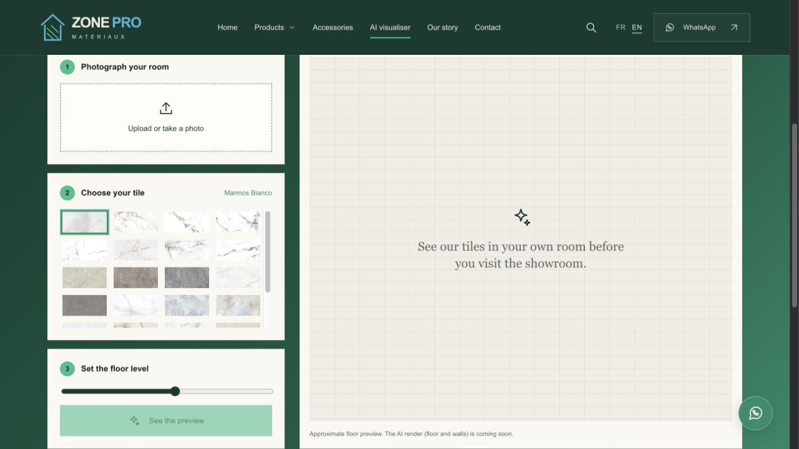

# Sufiyan Ali
**Full-Stack Developer · UI-Focused Engineer · Problem Solver**

[Portfolio](https://www.suffynux.com) · [LinkedIn](https://www.linkedin.com/in/sufiyan-ali-suffynux) · suffynux@gmail.com

---

## Intro

Full-stack developer with hands-on experience building scalable, production-ready web applications and cross-platform desktop tools. Strong focus on clean architecture, maintainable code, and performance-driven UI development. Comfortable working across the full development lifecycle — from concept to deployment — and actively contributing to live products.

**Core Focus Areas:**
MERN Stack · Next.js · TypeScript · Backend APIs · UI/UX Implementation · AI Integration · Shopify Development

---

## Technical Skills

| Area | Technologies |
|---|---|
| **Frontend** | React, Next.js, TypeScript, JavaScript, Tailwind CSS |
| **Backend** | Node.js, Express.js, Django, Flask |
| **Languages** | JavaScript, TypeScript, Python, C++ |
| **Databases** | MongoDB, PostgreSQL |
| **Desktop** | Tauri (Next.js → cross-platform desktop apps) |
| **AI / ML** | Google Gemini API, LLM integration, AI agent workflows |
| **Shopify** | Theme development (Liquid), custom app development, storefront APIs, CRM integrations |
| **Tools & Infra** | Git, Docker, Socket.io, Postman, Prisma, Cloudinary, Figma, Canva |

---

## Active Projects

Projects I am actively building, maintaining, and contributing to:

### [Gomila OMS](https://www.gomilaoms.com/) · E-commerce operations platform

  

**An order is only the beginning.** A footwear retailer still needs to verify payment, allocate stock, coordinate custom production, dispatch the parcel, resolve returns and reconcile the money. I built Gomila OMS to connect that operational chain in one role-based workspace.

- **Orders and fulfilment:** Shopify orders, staged queues, payment checks, branch assignment, split orders and dispatch exceptions.
- **Custom production:** made-to-order specifications, reference images, verification, production, quality and packing handoffs.
- **Stock and integrations:** retail inventory visibility and synchronisation with storefront and operational systems.
- **Delivery and after-sales:** courier workflows, returns, exchanges, refund ownership and operational reporting.
- **Sales reconciliation:** online and branch reporting distinguishes prepaid money received from COD orders that have actually been delivered.
- **Background work:** synchronisation jobs, retry handling and role-based access support the workflow between teams.

*Stack:* Next.js · TypeScript · Supabase · PostgreSQL · commerce and courier integrations

*Screenshot:* current live order-entry interface, captured 29 October 2026 with customer fields empty. The workspace requires authorised sign-in.

[Earlier refund-workspace case study](https://github.com/Suffynux/Unified-Inbox-Readme) — historical documentation of one part of the wider OMS.

---

### [Cega](https://cega.com.pk) · [Case Study](https://github.com/Suffynux/Cega-Readme)

  

Full-stack platform for Pakistan's national gaming & animation education hub, backed by the Ministry of IT & Telecom — 10,000+ students trained. Built the complete CRM layer: applicant lifecycle management, a two-phase multi-judge scoring & evaluation system, batch/cohort analytics, resource booking (meeting rooms, co-working, rendering lab), and an AI chatbot assistant.

*Stack:* Next.js · TypeScript · MongoDB · NextAuth.js · OpenAI API

---

### [Zone Pro Matériaux](https://www.zonepromateriaux.com/en) · Bilingual catalogue & room visualiser

  

A French/English showroom website for a materials business in Groslay, France. Built to help customers explore tile collections, compare sizes and finishes, inspect product references and start an enquiry with useful context.

- Bilingual navigation that preserves the current page and filters.
- Catalogue search, categories, product details, image zoom and coverage estimates.
- Product-specific enquiry links and responsive layouts for phone and desktop.
- A room-photo visualiser that connects product discovery to the customer's own space.

#### AI room visualiser / floor & wall feature

  

**Available in the public preview:** an approximate, browser-based floor preview. Customers choose a photo and a catalogue tile, adjust the floor level and compare before/after. This quick-preview mode processes the photo on the device.

**Implemented in source, pending public activation:** a Gemini image-rendering integration for floors, walls or both. The public deployment reviewed on 29 October 2026 still labels the AI render “coming soon”; a live AI-generated result was not verified.

*Stack:* Next.js · React · TypeScript · Canvas · Gemini image API integration

[Explore the website](https://www.zonepromateriaux.com/en) · [Open the visualiser](https://www.zonepromateriaux.com/en/visualiseur)

*Status:* publicly accessible preview on the project's domain. The site retains sample-content/pricing notices and business details awaiting confirmation.

---

### [Gomila PK](https://gomilaintersole.pk) · [Case Study](https://github.com/Suffynux/Gomila-PK-Readme)

  

Pakistan's home-market storefront for a luxury footwear brand — 5,000+ SKU catalog, managed end-to-end. Built a custom Nike-inspired product page with a working pre-order system, automated shoppable-video merchandising (Reels & Export Sample Sale), a self-running deals calendar, a bulk product-photo styling system for consistent imagery at scale, and a custom Apple-inspired checkout with local payment methods (COD, bank transfer, BNPL).

*Stack:* Shopify · Liquid · JavaScript · Metafields · Smart Collections · Storefront/Admin APIs

---

### [Gomila International UK](https://gomilaintersole.com) · [Case Study](https://github.com/Suffynux/Gomila-UK-Readme)

  

The international counterpart to the Pakistan store — same theme architecture and merchandising systems, reconfigured for a cross-border buyer: international checkout, a market/region gate, and a dedicated Export Sample Sale channel for moving export-grade overstock globally.

*Stack:* Shopify · Liquid · JavaScript · Metafields · Smart Collections · Storefront/Admin APIs

---

### Centro — New Home Tender Generator · [Case Study](https://github.com/Suffynux/Centro-Readme)

  

Sales software for an Australian home builder, built in **two versions sharing one pricing engine and PDF layout** — a cross-platform **Electron desktop app** that runs fully offline (local JSON storage, PDFs rendered in-process, Windows/macOS installers) and a **Next.js + MongoDB web app** for multi-user teams. Live pricing across designs, facades, landscaping, council charges and upgrade packs; an admin-editable catalog so the client maintains their own prices; plus a house & land brochure generator handling commission, rebates and lot-fit filtering.

Web security built in: bcrypt hashing, httpOnly JWT sessions verified in edge middleware, role-based access enforced server-side, and tiered API rate limiting.

*Stack:* Electron · React · Next.js 14 · MongoDB · jose · bcryptjs · Tailwind · Radix UI

---

### [JK News Records](https://jk-new-one.vercel.app) · [GitHub](https://github.com/Suffynux/jk-new)

  

A newsroom production tracker built for **JK News**, an Azad Kashmir & Manchester-based news channel with 239,000+ followers. Manages the full flow of news creation from first draft to deadline through a 5-stage pipeline — In Progress → Voice Over → Video/Editing → On Air → Done — on a mobile-first Kanban board, because the team works from phones.

- **Automatic turnaround timing** — a timer starts when a story is created and stops at Done; elapsed time shows live on every card
- **Overdue alerts** — anything not aired within an hour turns red, with overdue counts in the header and per-day badges
- **One-click branded PDF day report** — everything completed today with start/finish times and turnaround
- **Full audit trail** — every move, edit, and deletion logged with user and timestamp on a server-paginated feed
- Role-based access control, search and stage filters, light/dark themes, toast notifications

*Stack:* Next.js 16 · React 19 · TypeScript · MongoDB (Mongoose) · NextAuth · Tailwind CSS v4 · jsPDF

---

### [Save My Tokens](https://save-my-tokens.vercel.app) · [GitHub](https://github.com/Suffynux/save-my-tokens) · MIT

  

Upload a 1,000-page PDF straight into an AI model and it burns your entire token budget before you ask a single question — most of it spent on layout and encoding overhead, not content. This converts the document to clean Markdown first, so the same file costs a fraction of the tokens and leaves room for the actual conversation. Built as an internal tool, then open-sourced.

- Converts PDF, DOCX, PPTX, XLSX, CSV, and HTML in one click via [Microsoft MarkItDown](https://github.com/microsoft/markitdown) in a Python serverless function
- Live token estimate alongside copy and download
- **Voice notes to text in 16 languages** — including Urdu, Hindi, Arabic, and Mandarin — so you can speak a prompt instead of typing it. Audio is downmixed and resampled client-side to 16 kHz PCM WAV, keeping the serverless function ffmpeg-free
- Zero storage, zero sign-in — files are processed and immediately discarded
- One-click self-hosting: fork, import to Vercel, deploy

*Stack:* Next.js 16 · TypeScript · Python · Microsoft MarkItDown · SpeechRecognition · Vercel Serverless

---

### [CV Glow AI](https://cv-glow-ai.vercel.app) · [GitHub](https://github.com/Suffynux/cv-glow-ai)
AI-powered resume parser and ATS analyzer. Helps recruiters and job seekers turn resumes into opportunities through intelligent scoring, keyword analysis, and structured feedback.

- Multi-format support: PDF, DOCX, and scanned documents via OCR
- Real-time ATS scoring (0–100) with section-by-section breakdown
- AI-generated suggestions powered by Google Gemini
- Built-in CRM for managing user resumes, analyses, and history
- **Desktop App:** Packaged as a cross-platform native desktop application using [Tauri](https://tauri.app), wrapping the Next.js frontend into a lightweight Mac/Windows/Linux binary

*Stack:* Next.js · TypeScript · Google Gemini API · PostgreSQL (Neon) · Prisma · Cloudinary · Tauri

---

### [Next GridIt](https://www.nextgridit.co.uk) · [GitHub](https://github.com/Suffynux/next-gridit)
Production web platform actively maintained and deployed.

*Stack:* Next.js · TypeScript · Tailwind CSS

---

### [Deeniverse](https://deeniverse.com) · [GitHub](https://github.com/Suffynux/deeniverse)
Online Quran learning platform with structured content delivery and interactive learning features.

*Stack:* React · Node.js · MongoDB

---

### [AI Agent Skills](https://github.com/Suffynux/ai-agent-skills)
Exploration and implementation of AI agent architectures, tool-use workflows, and skill-based automation pipelines.

*Stack:* Python · LLM APIs · Agent frameworks

---

## Other Projects

**Portfolio Website** — Modern, responsive personal portfolio highlighting development and UI/UX work.
*Stack:* Next.js · Tailwind CSS · TypeScript

**ChatCord** — Real-time team chat application with WebSocket communication.
*Stack:* Node.js · Express · Socket.io

**Video Tube** — Full-stack video sharing platform with authentication and media handling.
*Stack:* MongoDB · Express · React · Node.js

---

## Desktop Distribution with Tauri

Production apps like CV Glow AI are packaged as lightweight native desktop binaries using [Tauri](https://tauri.app). This approach wraps a Next.js frontend into a cross-platform executable (Mac, Windows, Linux) without the overhead of Electron — resulting in smaller bundle sizes, native OS integration, and faster startup times.

---

## Current Focus

- Maintaining and scaling production projects (CV Glow AI, Cega, Next GridIt, Gomila)
- Shopify store development, CRM integrations, and e-commerce automation
- Building open-source AI productivity tooling (Save My Tokens)
- Improving system design and advanced React patterns
- Deepening expertise in AI integration and agent-based workflows
- Long-term exploration of cybersecurity specialization

---

## Collaboration & Networking

Open to full-stack and MERN-based projects, Shopify store development and integrations, frontend-heavy roles with strong UX focus, and remote collaboration or freelance opportunities.

---

*Building reliable software through clarity, consistency, and continuous improvement.*
