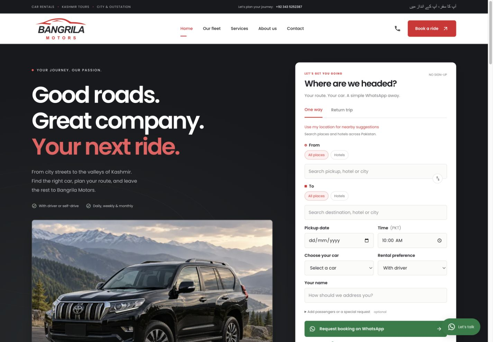
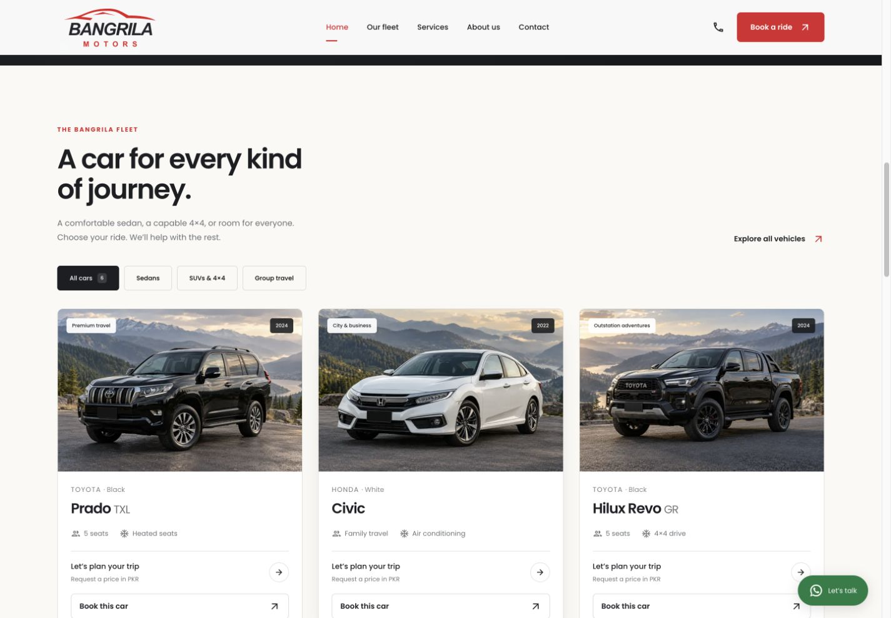

# Bangrila Motors

From choosing a car to a useful WhatsApp enquiry.

A focused booking journey helps the customer provide the details the business needs, before the conversation starts.

## Plan the journey

Customers choose pickup and destination, one-way or return travel, dates and driver or self-drive options. Location search supports places and hotels, with manual entry as a fallback.

Choose route and dates → Add travel preferences → Review the enquiry

*Live interface, reviewed 29 October 2026. No records were changed.*

## Choose a vehicle

A filterable fleet presents vehicle categories, seating and travel use cases. Selecting a car carries that context into the booking form.

Browse sedans, SUVs or group travel → Inspect the vehicle → Prefill the enquiry with that car

*Live interface, reviewed 29 October 2026. No records were changed.*

## Continue on WhatsApp

The form prepares a message for the owner containing the route, dates, selected car, notes and location links. The customer reviews the draft in WhatsApp and taps Send.

Complete the trip details → Open a prefilled WhatsApp draft → Agree availability and price with the owner

*This is a car-enquiry workflow, including hotel pickup/location search. It does not confirm availability, take payment or reserve hotel rooms.*

Reviewed against the project source and live interfaces on 29 October 2026. Screenshots document functionality; dashboard figures are snapshots, not claims of business uplift.

[Back to profile](../README.md)
