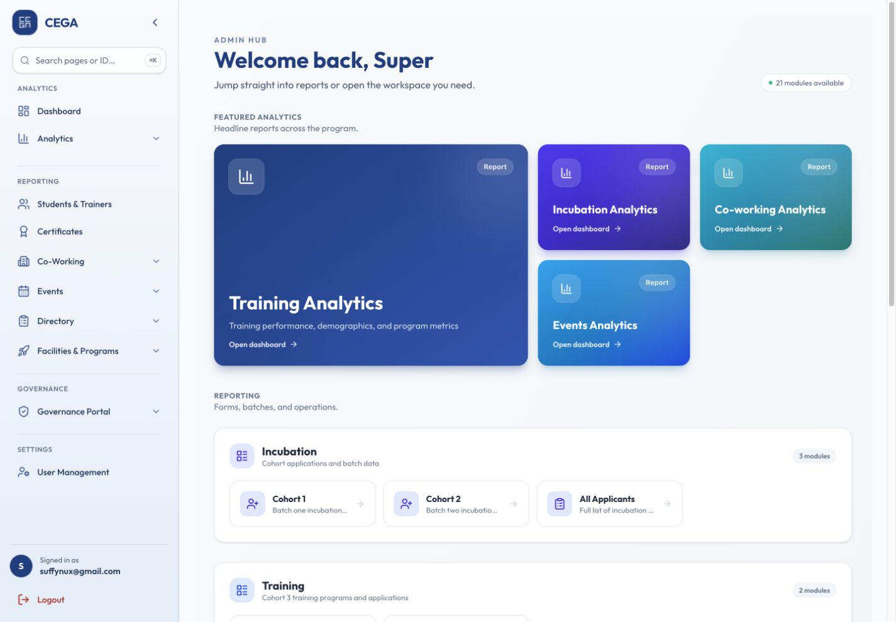
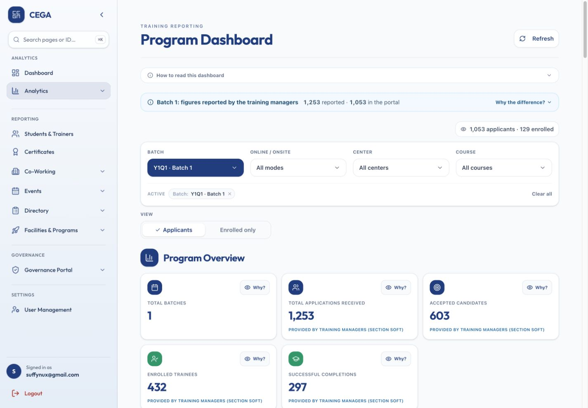
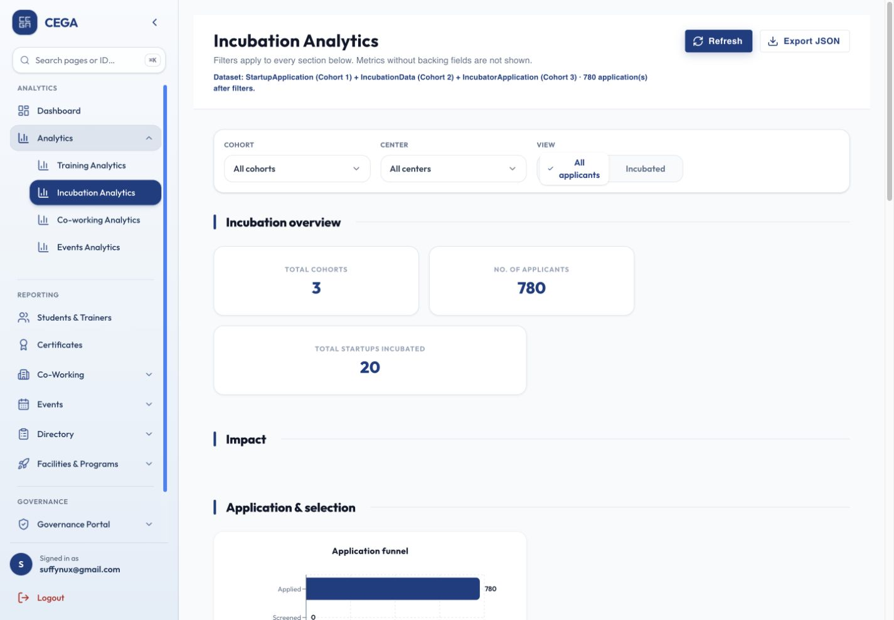
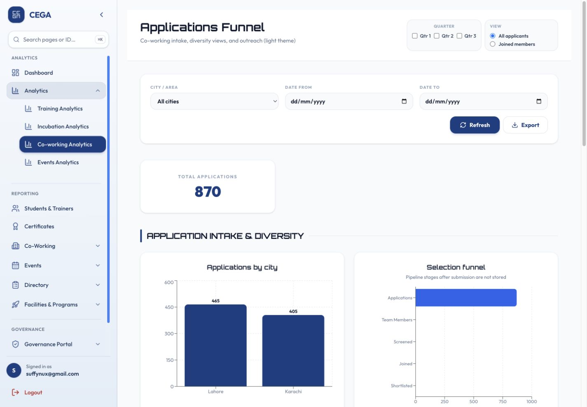
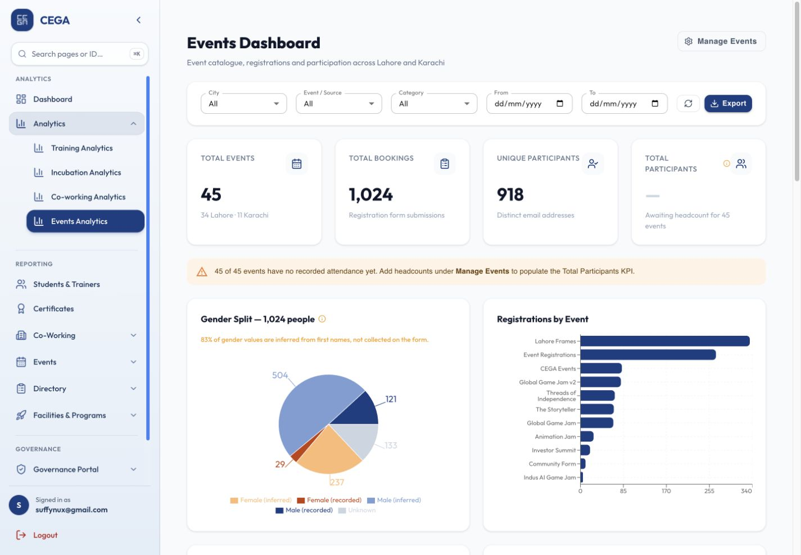

# CEGA

From an application to a whole programme.

CEGA connects public applications with the staff tools needed to run training, incubation, shared spaces and events.

## One staff workspace

A role-aware hub connects programme dashboards, application management, certificates, bookings, judging and governance. Public forms feed the protected backend.

Public application or booking → Authorised staff workspace → Programme-specific action

*Live interface, reviewed 29 October 2026. No records were changed.*

## Training & certificates

Training reporting combines cohort and legacy application records. Staff can compare batches, courses and centres, manage intake, and issue certificates with token-based retrieval.

Apply to a course → Review applications and track cohort progress → Issue and retrieve certificates

*Current aggregate reporting. Manager-reported totals and portal records are distinct; student-level scores are excluded.*

## Incubation & judging

Founder applications progress through cohort review and two judging phases. The source implements six criteria per phase, reviewer permissions and normalised scoring across multiple judges.

Founder submits an application → Authorised judges score in two phases → Staff review cohort outcomes

*Dashboard captured live; judging workflow verified in the repository. No private applicant scores are shown.*

## Shared spaces

Co-working applications, meeting-room bookings and rendering-lab requests give staff a structured way to handle access to facilities.

Request a workspace or resource → Review availability and booking details → Manage the facility workflow

*Live interface, reviewed 29 October 2026. No records were changed.*

## Events & governance

Event dashboards separate the event catalogue from registrations. Governance modules organise KPI groups, partner entries and rollups; calendar reminders are scheduled every ten minutes.

Register or submit a programme entry → Staff review reports and KPI records → Coordinate the next activity

*Live event aggregates. Registrations are not attendance; missing attendance remains distinct from zero.*

Reviewed against the project source and live interfaces on 29 October 2026. Screenshots document functionality; dashboard figures are snapshots, not claims of business uplift.

[Back to profile](../README.md)
