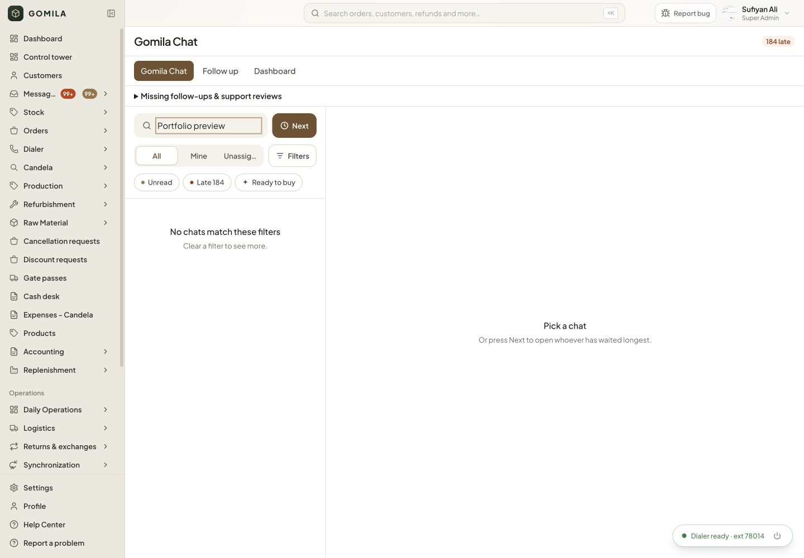
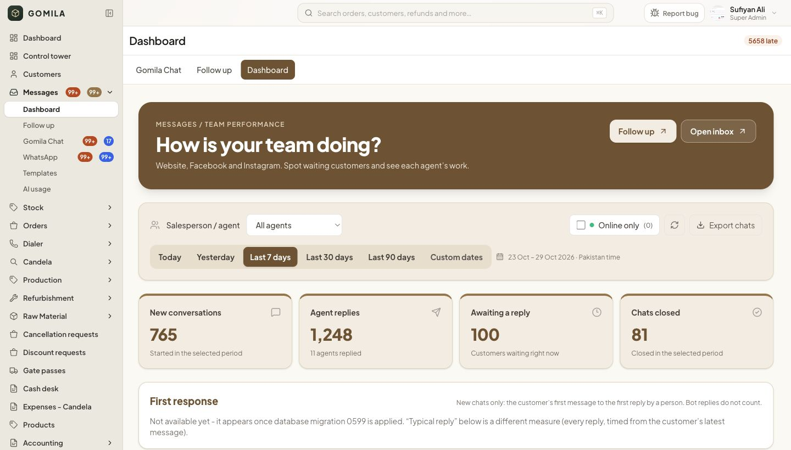
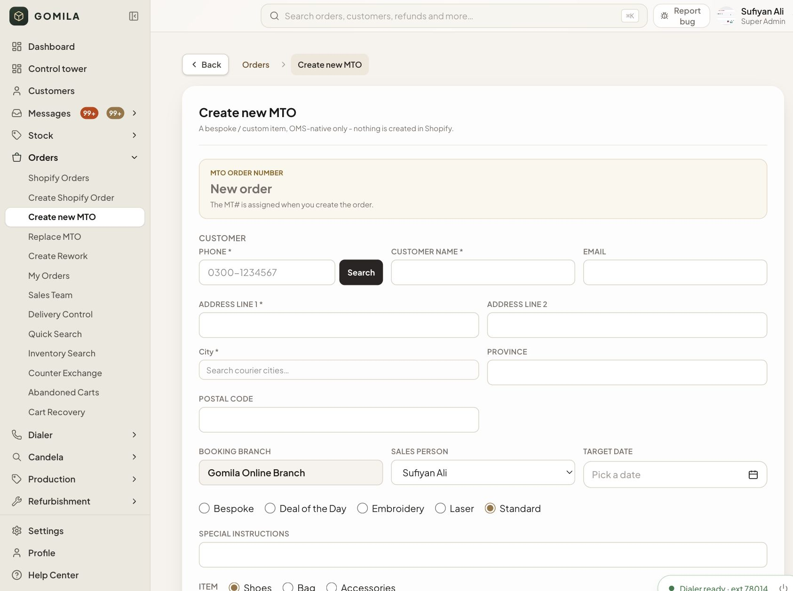
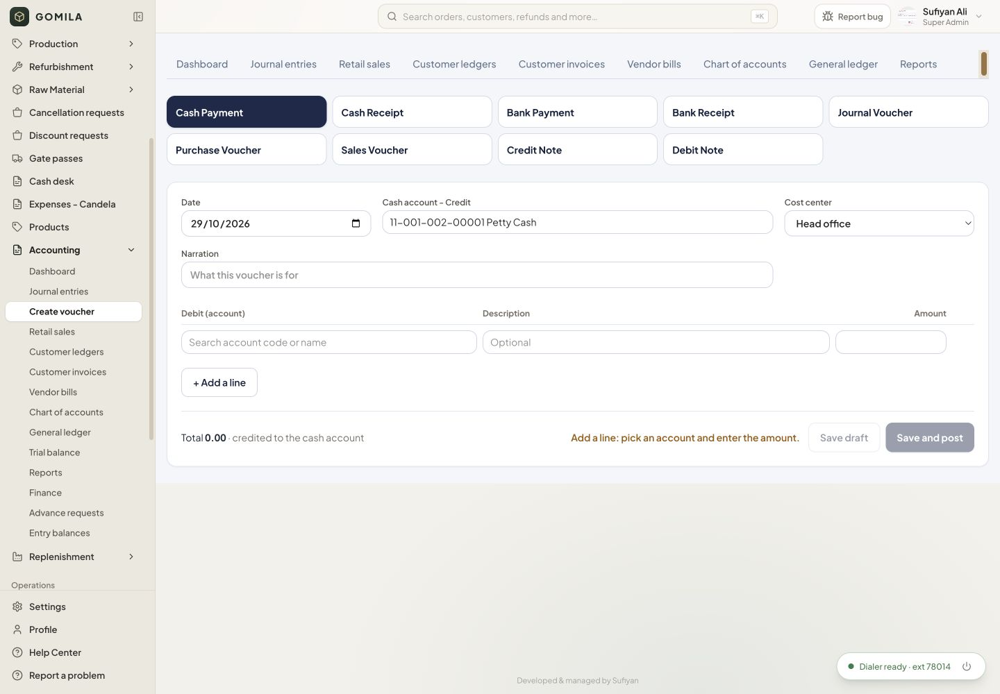
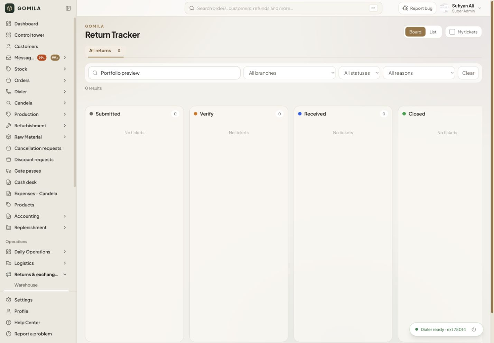
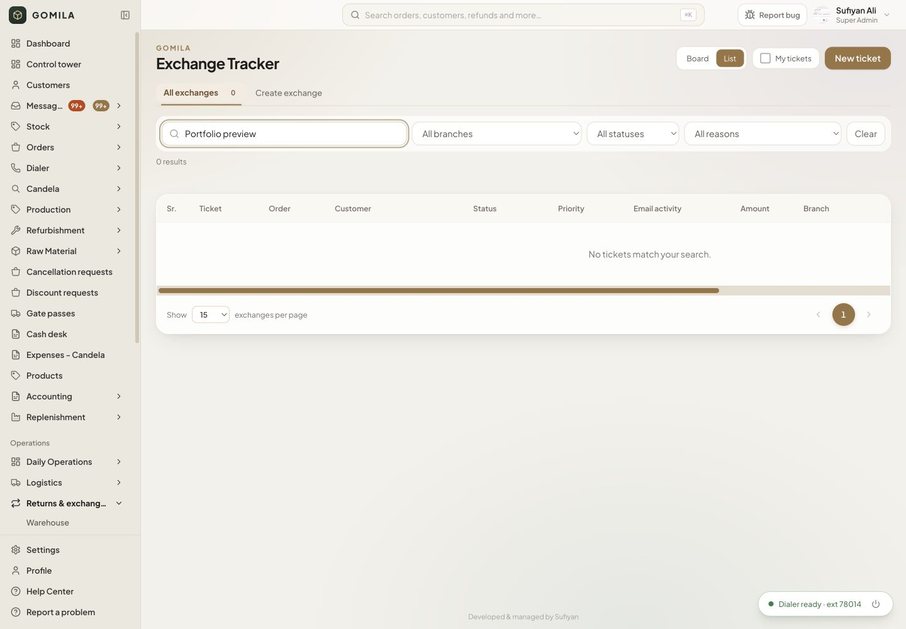

# Gomila OMS

A guided look inside the operation.

Follow the work across customer support, production, finance and after-sales. These are connected parts of the same business system.

## Customer conversations

A shared inbox brings website, Facebook and Instagram conversations into a team workflow, with ownership, waiting-time indicators, follow-ups, attachments and AI assistance. WhatsApp has a separate workspace.

Customer asks a question → Agent takes ownership and uses customer/order context → Follow-up stays visible to the team

*Search filtered for privacy; customer messages and details are not displayed.*

## Support analytics

Managers can filter by agent and period to review new conversations, replies, waiting customers and closed chats. The interface distinguishes first-response tracking from typical reply time.

Choose period and team → Review workload and response measures → Find where attention is needed

*Aggregate live snapshot, not a claim of performance improvement. First-response tracking was marked pending migration.*

## Custom production

A structured order brief captures the booking branch, owner, target date and item specifications before production handoffs.

Capture requirements → Verify, produce and check quality → Pack and dispatch

*Blank order form; no customer record was created.*

## Finance & reconciliation

A dedicated accounting workspace includes vouchers, journals, customer ledgers, invoices, vendor bills, chart of accounts, general ledger and reporting. Different voucher types support everyday accounting tasks.

Select voucher and cost centre → Enter balanced accounting details → Draft or post into the ledger

*Blank voucher interface; no transaction was saved or posted.*

## Returns

A return is operational work with an owner and a next stage. Teams can switch between a list and board, then filter by branch, status or reason.

Submitted → Verify and receive → Close the return

*Search filtered for privacy. Empty columns show the real workflow, not an absence of business activity.*

## Exchanges

Exchanges have their own tracker and creation flow while sharing the wider ticket workspace. Branch and status filters keep after-sales work organised.

Find the original order → Create and track the exchange → Resolve the customer request

*Search filtered for privacy; no exchange was submitted.*

Reviewed against the project source and live interfaces on 29 October 2026. Screenshots document functionality; dashboard figures are snapshots, not claims of business uplift.

[Back to profile](../README.md)
