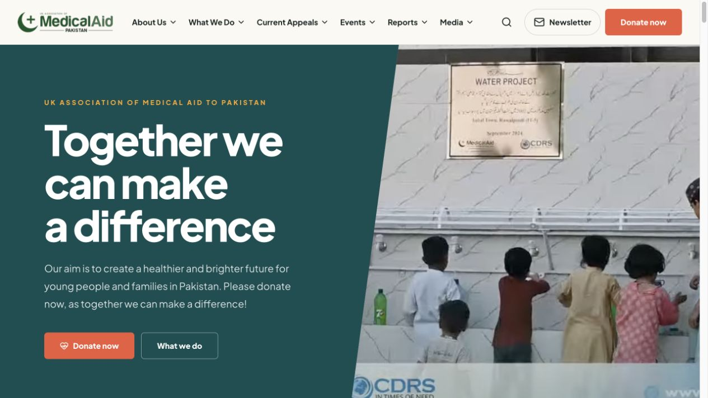
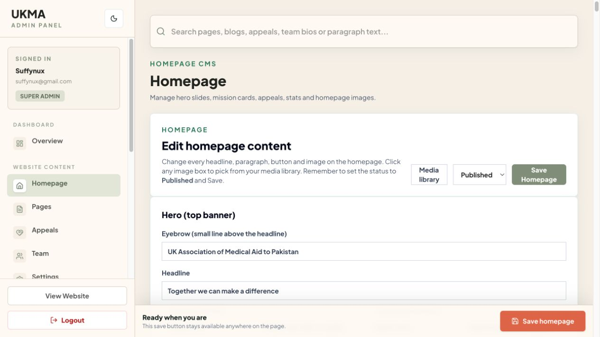
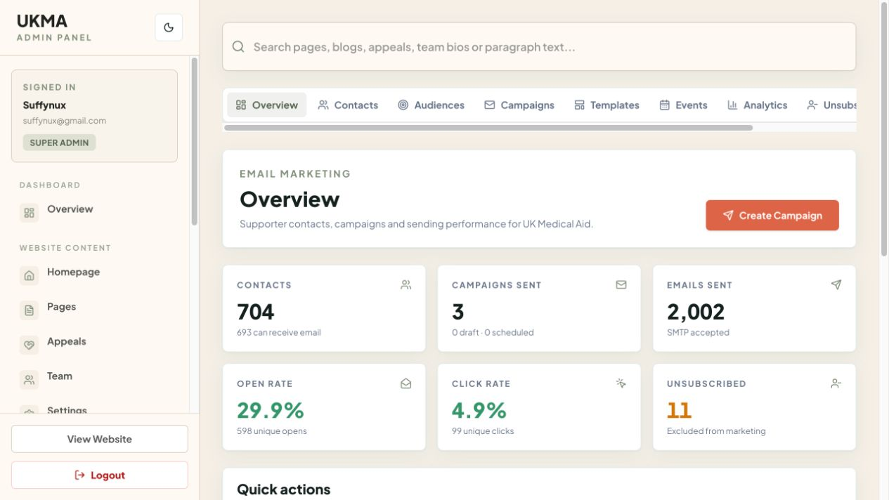
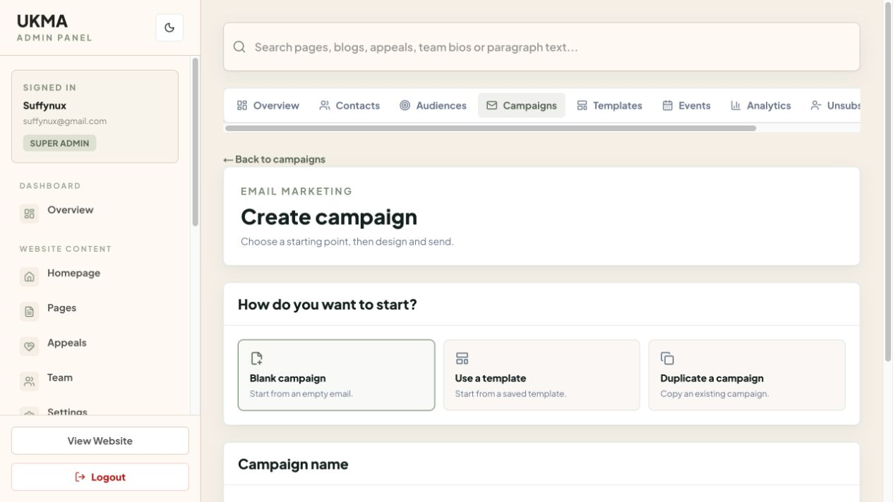
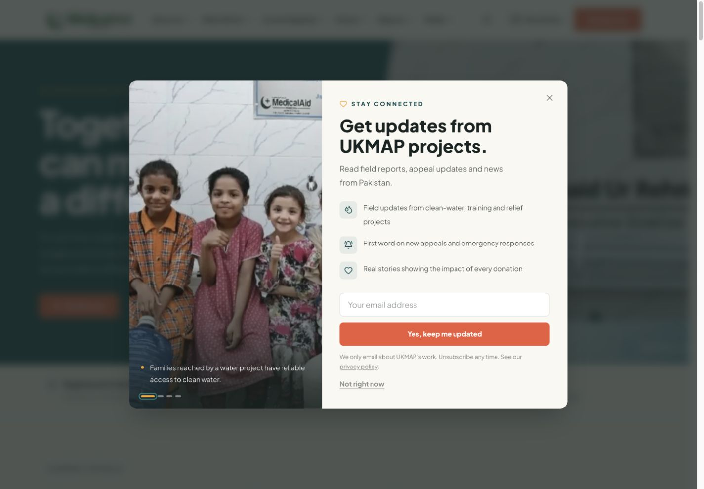

# UK Medical Aid

A website the team can run. An audience they can reach.

The public website, custom CMS and email engine form one platform for publishing the charity’s work and keeping supporters informed.

## Public discovery

Visitors explore programmes, appeals, events and impact reports, with clear routes to donate or hear more. Donation buttons hand off to the external fundraising service.

Discover the cause → Explore programmes and appeals → Donate or subscribe

*Live interface, reviewed 29 October 2026. No records were changed.*

## Custom content management

Editors manage homepage sections, pages, appeals, team profiles, blogs, images and site settings through a custom admin interface. MongoDB stores content and Cloudinary supports media.

Edit copy and imagery → Review publishing status → Publish through the CMS

*Live CMS editor captured without saving any changes.*

## Campaign engine

A built-in email platform manages contacts, audiences, templates, campaigns, events and analytics. Engagement reporting includes opens, clicks and unsubscribes.

Build a subscribed audience → Design and schedule a campaign → Review sending and engagement

*Live aggregate snapshot. SMTP acceptance is not guaranteed inbox delivery; opens are tracking signals, not confirmed reading.*

## Compose & schedule

Start blank, use a saved template or duplicate a campaign. The source supports audience selection, previews, scheduling, batched delivery, retries, pause/resume and provider quota handling.

Choose content and recipients → Schedule eligible sending → Process queue and track results

*Composer entry screen captured live. Queue and scheduling behaviour verified in source; no campaign was created or sent.*

## Supporter lifecycle

Newsletter signups join the supporter workflow. CSV imports validate and deduplicate contacts; unsubscribed recipients are excluded and subscription status is checked again before sending.

Newsletter signup or validated import → Audience segmentation and campaign → One-click unsubscribe and suppression

*Campaign cron is configured every five minutes. Scheduled time determines eligibility; exact-second delivery is not guaranteed.*

Reviewed against the project source and live interfaces on 29 October 2026. Screenshots document functionality; dashboard figures are snapshots, not claims of business uplift.

[Back to profile](../README.md)
